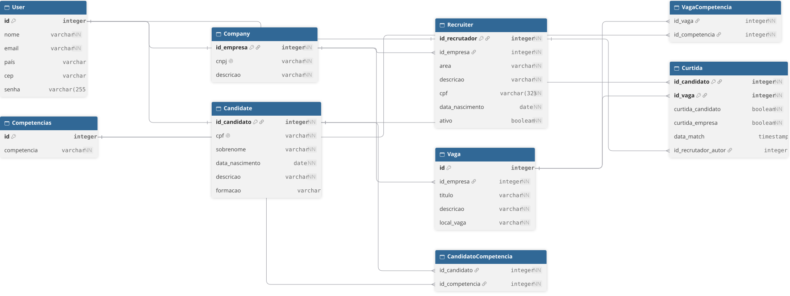

# Linketinder REST API

Backend do Linketinder em Groovy, sem framework web, usando HttpServer do JDK,
JDBC e PostgreSQL. Além dos cadastros e da integração com o
[frontend](https://github.com/Athus27/Linketinder-FrontEnd), implementa o
recrutador do desafio K2-T5, com sessão, autorização, curtidas e match.

## Endpoints atuais

| Método | Endpoint | Descrição |
|---|---|---|
| GET | `/api/candidatos` | Lista candidatos |
| GET | `/api/candidatos/{id}` | Busca candidato |
| DELETE | `/api/candidatos/{id}` | Exclui o próprio candidato autenticado |
| GET | `/api/empresas` | Lista empresas |
| GET | `/api/vagas` | Lista vagas |
| POST | `/api/candidatos` | Cadastra candidato e competências |
| POST | `/api/empresas` | Cadastra empresa |
| POST | `/api/vagas` | Empresa autenticada cadastra vaga e competências |
| POST | `/api/auth/login` | Valida e-mail/senha e retorna perfil e token |
| POST | `/api/auth/logout` | Revoga a sessão Bearer |
| GET, POST | `/api/recrutadores` | Empresa lista e cadastra seus recrutadores |
| DELETE | `/api/recrutadores/{id}` | Empresa desativa seu recrutador |
| GET | `/api/vagas?minhas=true` | Empresa/recrutador consulta as vagas da própria empresa |
| POST | `/api/curtidas` | Registra interesse no par candidato–vaga |
| GET | `/api/matches` | Lista matches e contatos autorizados do usuário |

Consultas e curtidas concluídas retornam 200; cadastros, 201; exclusão de
candidato e desativação de recrutador, 204 sem corpo. Login inválido ou sessão
inválida retorna 401; operação não permitida ao perfil retorna 403. Conflitos
de unicidade retornam 409; candidato inexistente retorna 404 nas consultas.
Listagens devolvem arrays JSON e respeitam as projeções de anonimato.

Candidato e empresa mantêm a senha mínima de 6 caracteres. Para recrutador,
a senha precisa ter de 8 a 72 bytes em UTF-8, com pelo menos uma letra e um
número; o CPF é validado e o nascimento exige idade mínima de 18 anos.

O desenvolvimento do recrutador seguiu SDD com apoio de agentes de IA. A
[spec](docs/specs/recrutador/spec.md), o [plano](docs/specs/recrutador/plano.md)
e o [registro de prompts e revisão](PROMPTS.md) documentam o trabalho nos dois
repositórios e seu estado de validação.

## Configuração e execução

### Modelo do banco

Diagrama exportado do dbdiagram com candidatos, empresas, recrutadores,
vagas, competências e curtidas:



O diagrama representa o estado do script completo `sql/Linketinder.sql`.
Triggers e detalhes executáveis permanecem definidos no SQL.

Tecnologias: Java 21, Groovy, Gradle Wrapper, PostgreSQL, JDBC e Spock. A JVM que inicia o Gradle precisa ser compatível com o wrapper; a toolchain não altera o Java do terminal.

### Banco novo

`sql/Linketinder.sql` é o script completo para um banco vazio: inclui
pgcrypto, recrutadores, índice de e-mail, trigger de normalização de CPF e
autoria da curtida. Ele já incorpora o estado das migrações V1 e V2.

```bash
createdb -h localhost -U seu_usuario linketinder
# Cria o banco somente se ele ainda não existir.
psql -h localhost -U seu_usuario -d linketinder -v ON_ERROR_STOP=1 -1 -f sql/Linketinder.sql
# Cria toda a estrutura atual em uma transação; requer permissão para instalar pgcrypto.
```

Não aplique V1/V2 depois desse script e não o execute sobre tabelas existentes.
Os dados fictícios de `sql/DadosIniciais.sql` são opcionais para estudo;
execute a carga somente em uma base de demonstração preparada para recebê-la.

### Banco existente

Não recrie o banco. Confira o alvo, faça backup e aplique somente as migrações
que faltam. Antes da V1, confirme que não há e-mails equivalentes após
`lower(trim(email))`:

```sql
SELECT count(*) FROM (
  SELECT lower(trim(email))
  FROM "User"
  GROUP BY lower(trim(email))
  HAVING count(*) > 1
) AS duplicados;
```

O resultado precisa ser `0`. Com o backup protegido, aplique V1 se necessário
e V2 somente se ela ainda não foi aplicada:

```bash
pg_dump -h localhost -U seu_usuario -d linketinder -Fc -f backup-antes-migracoes.dump
# Salva um backup local; proteja esse arquivo e não o versione.
psql -h localhost -U seu_usuario -d linketinder -v ON_ERROR_STOP=1 -1 -f sql/migrations/V1__unique_user_email_normalized.sql
# Garante o índice único de e-mail normalizado em bancos legados.
psql -h localhost -U seu_usuario -d linketinder -v ON_ERROR_STOP=1 -1 -f sql/migrations/V2__recruiter_and_like_author.sql
# Adiciona recrutadores e autoria da curtida em uma transação; não reaplicar V2.
```

Um banco que já recebeu V2 não precisa executar nenhum desses scripts para
esta atualização. Sem Recruiter, o login desta versão não funciona.

### Conexão e execução

Crie `app/src/main/resources/db.properties`, ignorado pelo Git:

```properties
db.type=postgres
db.url=jdbc:postgresql://localhost:5432/linketinder
db.user=seu_usuario
db.password=sua_senha
```

```bash
./gradlew run
# Inicia a API em http://localhost:8080.
```

As variáveis `HOST`, `PORT` e `FRONTEND_ORIGIN` alteram endereço, porta e origem autorizada. O padrão do frontend é `http://localhost:5173`.

## Testes automatizados

```bash
./gradlew check
# Executa testes unitários e de integração configurados no projeto.

./gradlew check --rerun-tasks
# Repete as verificações mesmo quando estão UP-TO-DATE.
```

O resumo mostra aprovados, falhos e ignorados por suíte. A integração usa
schemas temporários e cobre criação do zero, migração, persistência,
concorrência de curtidas e projeções HTTP. O teste de bootstrap compara o
script completo com uma fixture histórica atualizada por V1/V2, incluindo
colunas, índices, constraints e trigger. A validação manual está em
[validação do recrutador](docs/specs/recrutador/validacao.md).

O `requests.http` contém consultas, cadastros e exclusão para o IntelliJ. Cada POST tenta gravar novamente os dados; campos únicos não podem ser repetidos indiscriminadamente. A requisição DELETE é destrutiva: confira o ID antes de executá-la.

## Organização e limites

O Router registra contextos; o CorsFilter verifica a origem; handlers tratam HTTP/JSON; controllers delegam aos DAOs, que executam SQL. Os handlers registram método, caminho, status e duração, sem corpo. Os erros das operações de cadastro não imprimem valores SQL ou credenciais.

O login verifica o hash com `pgcrypto` e emite token opaco, mantido em memória
por até quatro horas. Envie `Authorization: Bearer <token>` nas operações
protegidas. Logout e reinício da API invalidam sessões; recrutador inativo
perde acesso mesmo com token anterior. A exclusão de candidato exige o próprio
titular e a criação de vaga exige empresa autenticada. PUT e exclusão de
empresas/vagas ainda não estão implementados.

Antes do match, candidatos são identificados apenas por ID técnico e mostram
competências/formação. O match libera os contatos do par autorizado, nunca
CPF, CNPJ, nascimento, senha ou hash. O recrutador representa sua empresa na
curtida; repetições não duplicam voto ou match. Consulte a
[spec](docs/specs/recrutador/spec.md) para os contratos completos. Este é um
ambiente local de estudo, não uma implantação de produção.

- [Contrato e exemplos da API](docs/api.md)
- [Como frontend e backend se conectam](docs/integracao-frontend-backend.md)
- [Arquitetura e construção sem framework](docs/arquitetura.md)
- [CORS e integração](docs/cors.md)
